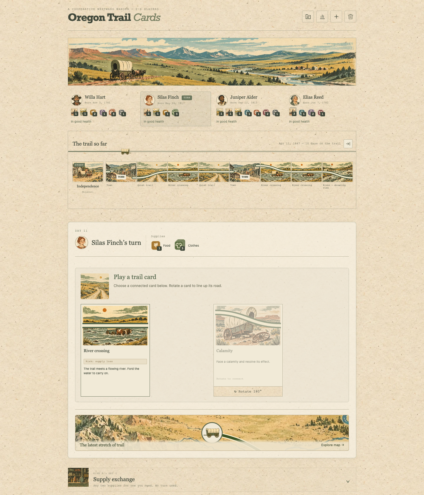
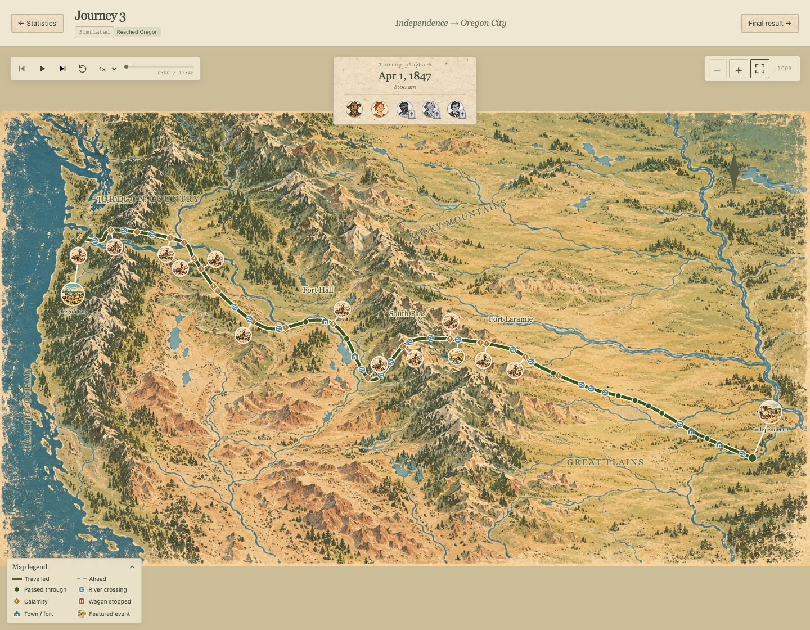
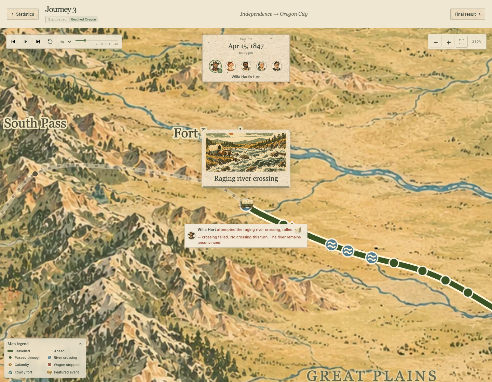
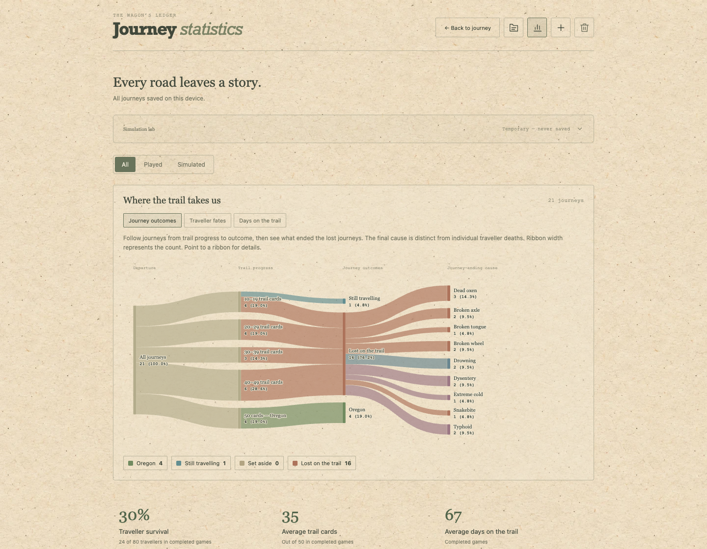

# Oregon Trail Cards

An Oregon Trail card game with local co-op and robo mode to confirm dysentery is indeed the leading cause of death.

[Play on GitHub Pages](https://aaronbeall.github.io/oregon-trail-cards/)

- Play solo, share a screen in local co-op, or bring computer companions.
- Connect trail cards, cross rivers, trade supplies, and survive calamities.
- Save journeys automatically and replay their events on an illustrated map.
- Compare outcomes with visual statistics, traveller fates, and temporary simulation batches.






## Run locally

```sh
npm ci
npm run dev
```

Built with TypeScript, Vite, GSAP, HTML/CSS, and generated illustrations. Saves stay in your browser; no account or backend required.

```sh
npm test
npm run build
npm run simulate -- --games 100 --players 3 --seed 1
```

[Rules and adaptations](docs/rules.md) — [Computer strategy and simulations](docs/computer-players.md) — [Saved history format](docs/history.md)

GitHub Actions builds and publishes GitHub Pages when changes are pushed to `main`.
