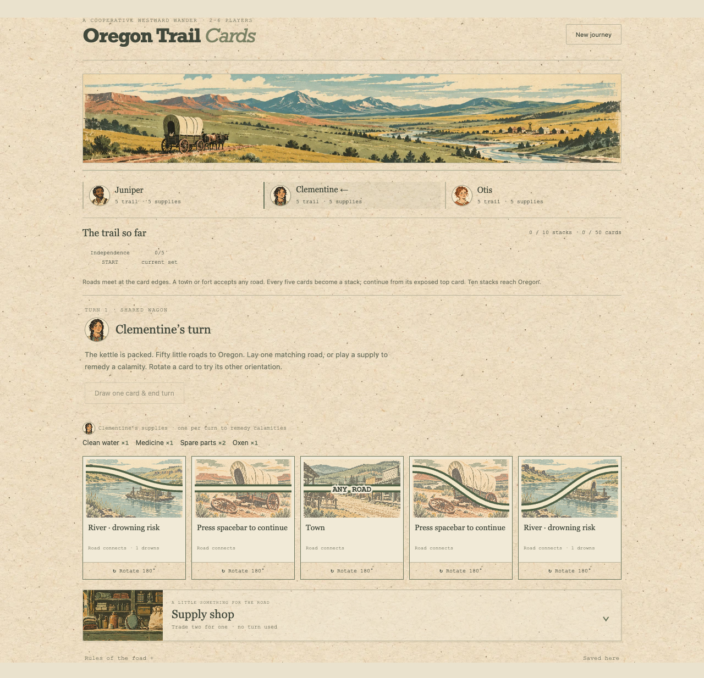

# Oregon Trail Cards

A cooperative westward wander for 2–6 travellers sharing one device. Play solo, local co-op, or alongside computer travellers. Connect and rotate roads, mind the calamities, and get at least one companion to Oregon. The kettle is counting on you.



## Play locally

```sh
npm install
npm run dev
```

Based on the 2017 Pressman base card game: separate player turns and supply hands, river attempts, timed calamities, wills, trades, and ten five-card trail stacks. The trail area shows the exposed stack tops and current connected cards. There are no automatic replacement draws or invented health/provision meters. Read the [rules reference and edition notes](docs/rules.md) for details and the explicitly documented calamity-pile exhaustion fallback.

Journeys save automatically in this browser. Each game also keeps a turn-by-turn action history, including choices, dice results, and replayable state changes, for future replay and stats. New games preserve previous journeys; see [local history format](docs/history.md). The previous solo-game saves are not loaded by the corrected version.

Built with TypeScript, Vite, GSAP, HTML/CSS, and generated distressed-print illustrations. No accounts or backend. Artwork and texture are in `assets/`; [art prompts](docs/art-prompts.md) and [additional artwork prompts](docs/additional-art-prompts.md) document their creation. Player portraits are randomly assigned and saved with each journey. `npm test` checks the rules and card conservation; `npm run build` checks types and builds `dist/`.

## Computer travellers and simulations

Choose Human or Computer using the icons on each wagon setup card. Computer travellers play at a relaxed pace, including card reveals and dice results; pause them during their turn or a result screen. All travellers default to human.

For a hands-off run, choose **Simulate journey** beneath the regular start button. It runs the whole party through a dedicated progress view, then shows results and an explorable journey map. These games are saved and marked **Simulated** in history.

The same browser-independent strategy can run entire seeded games without a UI:

```sh
npm run simulate -- --games 100 --players 3 --seed 1
```

See [computer strategy and automation](docs/computer-players.md) for decision priorities, controls, limitations and the reusable headless API.
